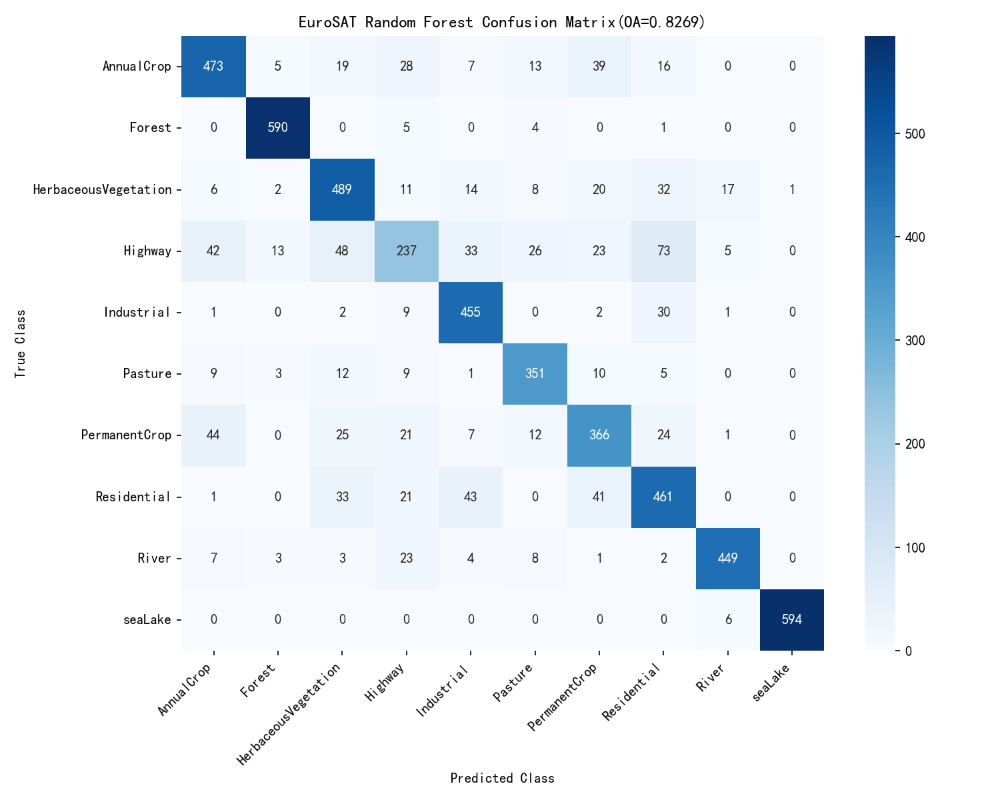
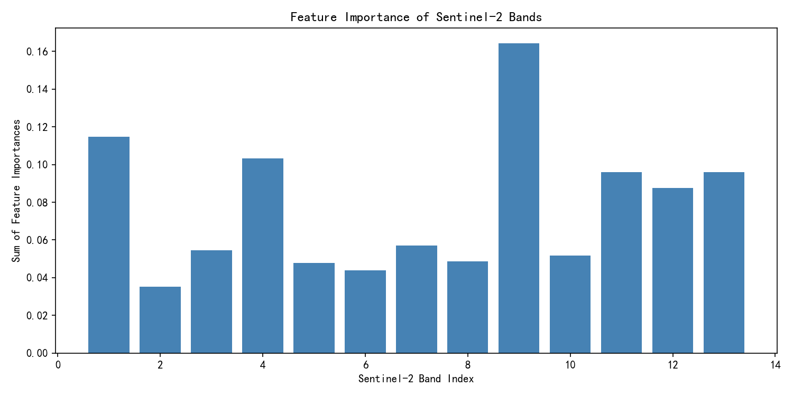

# EuroSAT-GeoAI-Classification

[English](#english) | [中文](#中文)

---

## English

### Project Overview
A GeoAI project for land cover classification using Sentinel-2 multispectral imagery from the EuroSAT dataset. This repository contains a Random Forest baseline and will be extended with CNN models.

### Dataset
- **Source**: EuroSATallBands (Sentinel-2)
- **Samples**: 27,000 images
- **Classes**: 10 (AnnualCrop, Forest, HerbaceousVegetation, Highway, Industrial, Pasture, PermanentCrop, Residential, River, SeaLake)
- **Bands**: 13 (including near-infrared and shortwave infrared)
- **Image size**: 64 × 64 pixels

### Method
- **Algorithm**: Random Forest (200 trees)
- **Features**: Each 13×64×64 image flattened into a 53,248-dimensional vector
- **Evaluation**: Overall Accuracy (OA), confusion matrix, feature importance

### Results
- **Overall Accuracy (OA)**: 0.8269
- **Key findings**:
  - Bands 9, 12, and 13 (narrow NIR, SWIR) are the most important.
  - Highway and Residential are easily confused due to mixed pixels.
- **Confusion Matrix**:
  
- **Band Importance**:
  

### Environment
- Python 3.10
- numpy, rasterio, scikit-learn, matplotlib, seaborn

### How to Run
```bash
git clone https://github.com/Arcturus6603/EuroSAT-GeoAI-Classification.git
cd EuroSAT-GeoAI-Classification
pip install -r requirements.txt
# Download EuroSATallBands and change path
```

### Future Work
- Add spectral indices (NDVI, NDWI) as extra features.
- Build CNN models with data augmentation.
- Compare Random Forest and CNN results.

---

## 中文

### 项目简介
本项目是一个 GeoAI 入门项目，使用 EuroSAT 数据集中的 Sentinel-2 多光谱遥感影像进行地物分类。仓库目前包含随机森林基线模型，后续将扩展 CNN 模型。

### 数据集
- **来源**：EuroSATallBands (Sentinel-2)
- **样本数**：27,000 张
- **类别数**：10 类（AnnualCrop、Forest、HerbaceousVegetation、Highway、Industrial、Pasture、PermanentCrop、Residential、River、SeaLake）
- **波段数**：13 个（含近红外、短波红外）
- **影像尺寸**：64 × 64 像素

### 方法
- **算法**：随机森林（200 棵树）
- **特征**：将每张 13×64×64 的影像拉平为 53,248 维向量
- **评估指标**：总体精度（OA）、混淆矩阵、特征重要性

### 结果
- **总体精度 (OA)**：0.8269
- **关键发现**：
  - 第 9、12、13 波段（窄近红外、短波红外）对分类最重要。
  - 公路与住宅因混合像元问题容易混淆。
- **混淆矩阵**：
  
- **波段重要性**：
  

### 环境依赖
- Python 3.10
- numpy、rasterio、scikit-learn、matplotlib、seaborn

### 如何运行
```bash
git clone https://github.com/Arcturus6603/EuroSAT-GeoAI-Classification.git
cd EuroSAT-GeoAI-Classification
pip install -r requirements.txt
# 下载 EuroSATallBands 并修改路径
```

### 未来计划
- 加入 NDVI、NDWI 等光谱指数作为额外特征。
- 搭建 CNN 模型，并加入数据增强。
- 对比随机森林和 CNN 的结果。
