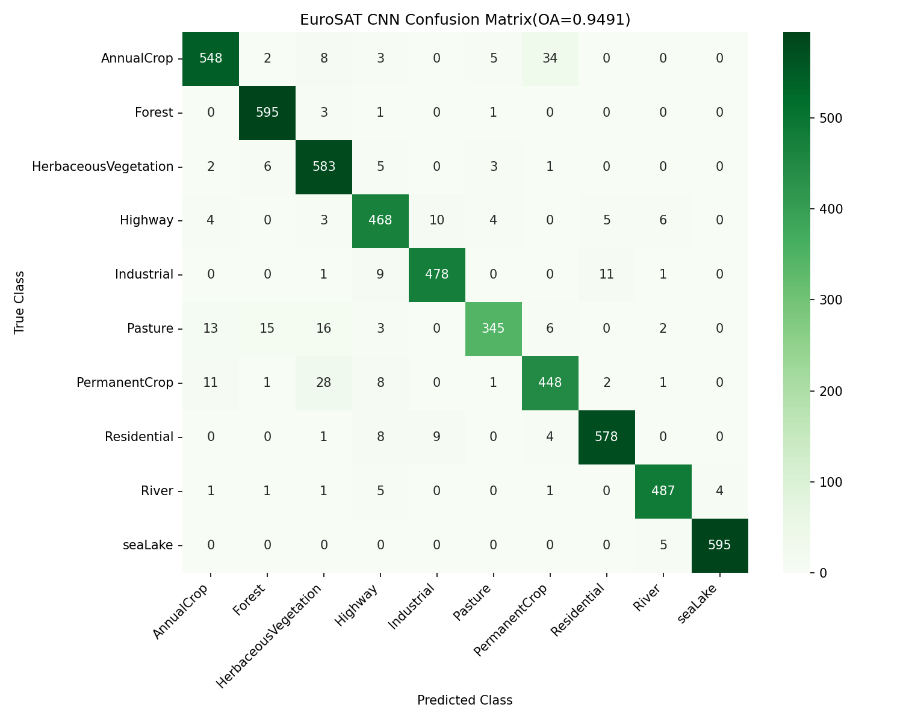

# EuroSAT-GeoAI-Classification

[English](#english) | [中文](#中文)

---

## English

### Project Overview
A GeoAI project for land cover classification using Sentinel-2 multispectral imagery from the EuroSAT dataset. This repository contains a **Random Forest baseline** and **Lightweight CNN model**.

### Dataset
- **Source**: EuroSATallBands (Sentinel-2)
- **Samples**: 27,000 images
- **Classes**: 10 (AnnualCrop, Forest, HerbaceousVegetation, Highway, Industrial, Pasture, PermanentCrop, Residential, River, SeaLake)
- **Bands**: 13 (including near-infrared and shortwave infrared)
- **Image size**: 64 × 64 pixels

### Method & Results
1.**Random Forest Baseline**:Flattened 13*64*64 images into 53248-dim vectors,OA=82.69%.\
2.**Lightweight CNN**:Custom 3-layer CNN.OA=94.22%(no aug)->94.91%(data augmentation).\
3.**Confusion Matrix Analysis**:
 - RF struggled with "Highway"(F1=0.548) due to spectral similarity.
 - CNN resolved this (F1=0.926)by extracting spectral textures.
 - 

### Ablation Study & Variance Analysis
Repeated experiments with/without random seeds and different epochs.
- Demonstrated that random initialization causes up to a 3.5% fluctuation in OA.
- By fixing the random seed and increasing epochs to 20,verified that data augmentation is effective.

### Environment
- Python 3.10
- numpy, rasterio, scikit-learn, matplotlib, seaborn

### How to Run
```bash
git clone https://github.com/Arcturus6603/EuroSAT-GeoAI-Classification.git
cd EuroSAT-GeoAI-Classification
pip install -r requirements.txt
# Download data and change path
#The data comes from https://opendatalab.com/OpenDataLab/EuroSAT
```

### Repository Structure
- 'src/':Source code for data loading,training and evaluation.
- 'model/':Saved model weights(.pth)
- 'results/':Confusion matrices,F1-score charts and classification report.
- 'requirements.txt':Python dependencies.


---

## 中文

### 项目简介
本项目是一个基于Sentinel-2多光谱影像(EuroSAT数据集)的GeoAI地物分类项目，包含**随机森林基线**与**轻量级CNN模型**。

### 数据集
- **来源**：EuroSATallBands (Sentinel-2)
- **样本数**：27,000 张
- **类别数**：10 类（AnnualCrop、Forest、HerbaceousVegetation、Highway、Industrial、Pasture、PermanentCrop、Residential、River、SeaLake）
- **波段数**：13 个（含近红外、短波红外）
- **影像尺寸**：64 × 64 像素

### 方法与结果
1.**随机森林基线**:将影像拉平为53248维向量，OA=82.69%。\
2.**轻量级CNN模型**:自定义3层卷积卷积网络，无增强OA=94.22%,加入数据增强后OA提升至94.91%。\
3.**混淆矩阵分析**:随机森林对公路(Highway)识别较差(F1=0.548)，CNN利用空间纹理特征将F1提升至0.926。
 -

### 消融实验与方差分析
通过改变随机种子和训练轮数进行对照。证实了未固定种子时模型存在最高达3.5%的精度波动；固定种子并增加轮数后，验证了数据增强的有效性。

### 环境依赖
- Python 3.10
- numpy、rasterio、scikit-learn、matplotlib、seaborn

### 如何运行
```bash
git clone https://github.com/Arcturus6603/EuroSAT-GeoAI-Classification.git
cd EuroSAT-GeoAI-Classification
pip install -r requirements.txt
# 下载数据并修改路径
# 数据来源于https://opendatalab.com/OpenDataLab/EuroSAT
```

### 目录结构
- 'src.':数据加载、训练与评估的源代码。
- 'models/':保存的模型权重文件(.pth)
- 'results/':混淆矩阵、F1分数表及分类报告。
- 'requirements.txt':环境依赖。
